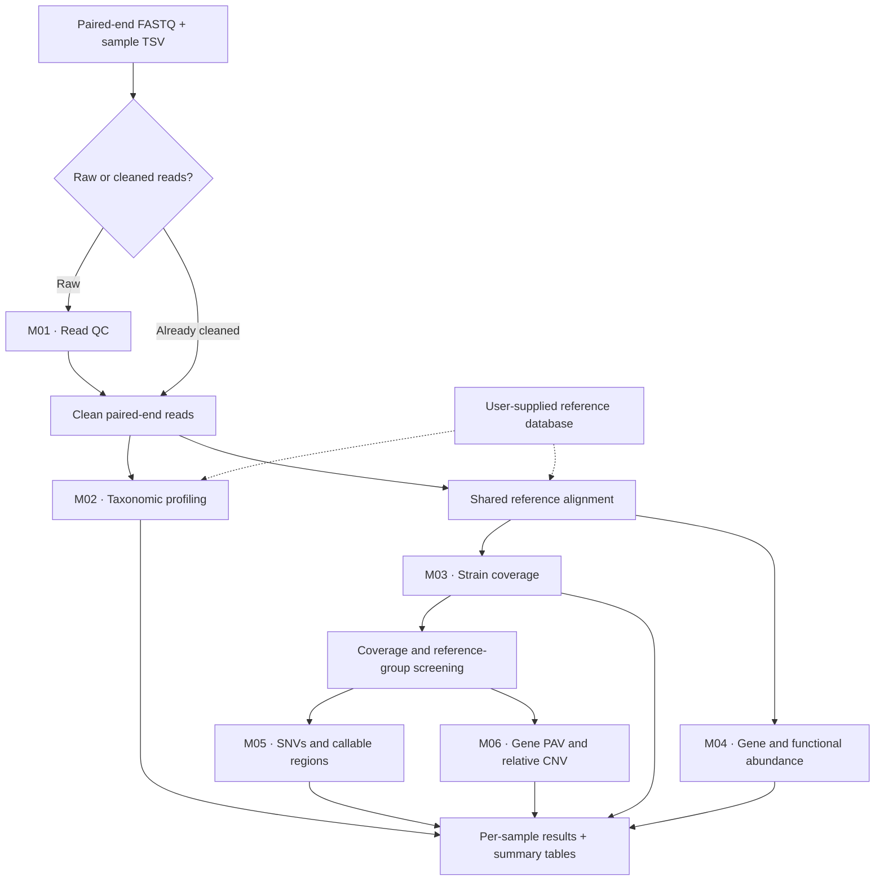

# SynCom-MetaFlow

**A modular, reference-based workflow for paired-end synthetic community metagenomics.**

**English** · [简体中文](README.zh-CN.md)

From paired-end reads to taxonomic profiles, reference-strain coverage, gene and functional abundance, single-nucleotide variants, and gene presence/absence and relative copy number. Choose the modules you need, inspect the generated Bash jobs, and run or resume them in your own analysis directory.

> **Before you start:** this repository contains core code and configuration examples. Reference databases, sequencing data, analysis results, and development test files are excluded. Prepare a compatible database and install the tools required by your selected modules.

[Workflow](#workflow) · [Modules](#modules) · [Quick start](#quick-start) · [Inputs](#inputs) · [Outputs](#outputs) · [Interpretation](#interpretation-and-defaults)

## Workflow



The Python controller validates inputs, resolves module dependencies, and writes a Bash execution plan. `plan` exports that plan; `run` exports and executes it. Samples currently run sequentially, with threading inside individual tools. M03 and M04 share a sorted reference-alignment BAM. During alignment, BWA and sorting overlap and each needs at least one core; allocate at least two cores even if `--threads 1` is requested.

## Modules

| Module | Analysis | Main tools | Main summary outputs |
|---|---|---|---|
| **M01** | Paired-end read QC | fastp | `qc.tsv` |
| **M02** | Taxonomic profiling | mOTUs, BWA | `taxonomy.tsv`, `taxonomy_matrix.tsv` |
| **M03** | Reference-strain and near-identical-group coverage | BWA, samtools | `strains.tsv`, `strains_matrix.tsv`, `strain_groups_matrix.tsv` |
| **M04** | Gene and annotated-function abundance | BWA, samtools, featureCounts | `genes.tsv`, `functions.tsv`, gene/function FPKM matrices |
| **M05** | Population SNVs and callable regions | M03 dependencies, bcftools | `snv.tsv`, `snv_eligibility.tsv` |
| **M06** | Gene presence/absence and relative copy number | M03 dependencies | `pav_cnv.tsv`, gene PAV/CNV matrices, `pav_cnv_eligibility.tsv` |

**Dependencies:** raw-read input automatically adds M01. M05 or M06 automatically adds M03. Use `--clean-reads` to bypass QC for samples that already have exactly one cleaned FASTQ pair; do not combine it with M01.

## Quick start

### 1. Get the code and configure tools

Use Linux, Python 3.10+ (the development environment uses Python 3.12), Bash, GNU command-line utilities, and `flock`. The Python controller uses the standard library.

```bash
git clone https://github.com/Astudentx/SynComMeta.git
cd SynComMeta

# Edit the right column to use commands on PATH or executable paths.
cp config/tools.example.tsv config/tools.local.tsv
./syncom-metaflow doctor --tools config/tools.local.tsv
./syncom-metaflow modules
```

`doctor` checks executable discovery for all six modules; it does not validate a database or run a full analysis. A `plan` or `run` command checks tools for its selected modules and dependencies. See [software configuration](#software-configuration) if you only need a subset.

### 2. Prepare your inputs

Prepare a tab-separated sample sheet and a compatible database directory containing `manifest.tsv`. Replace `/path/to/samples.tsv` and `/path/to/SynComDB` below with your real paths. See [Inputs](#inputs) for the required formats.

### 3. Run the full workflow

```bash
./syncom-metaflow run \
  --samples /path/to/samples.tsv \
  --db /path/to/SynComDB \
  --tools config/tools.local.tsv \
  --modules M01,M02,M03,M04,M05,M06 \
  --threads 4 \
  --outdir results/batch01
```

Start with `results/batch01/summary/` for combined tables and `results/batch01/provenance/status.tsv` for run completion.

### 4. Or export jobs for later execution

```bash
./syncom-metaflow plan \
  --samples /path/to/samples.tsv \
  --db /path/to/SynComDB \
  --tools config/tools.local.tsv \
  --modules M01,M02,M03,M04,M05,M06 \
  --threads 4 \
  --outdir results/batch01

nohup bash results/batch01/shell/run_all.sh \
  > results/batch01/run.log 2>&1 &
```

The generated `shell/run_all.sh` can be called from any working directory using its absolute path. You can also invoke it from an HPC batch job; scheduler submission is managed separately. Plans retain paths to reads, databases, and executables, so those resources must remain accessible.

## Inputs

### Sample sheet

Use a **TSV file with a header**, as in [examples/samples.tsv](examples/samples.tsv):

```tsv
sample_id	r1	r2	lane_id
sample01	reads/sample01_L001_R1.fastq.gz	reads/sample01_L001_R2.fastq.gz	L001
sample01	reads/sample01_L002_R1.fastq.gz	reads/sample01_L002_R2.fastq.gz	L002
sample02	reads/sample02_L001_R1.fastq.gz	reads/sample02_L001_R2.fastq.gz	L001
```

| Field | Required | Meaning |
|---|---|---|
| `sample_id` | Yes | Sample identifier: starts with a letter or digit; contains letters, digits, `_`, `.`, or `-` |
| `r1`, `r2` | Yes | Mate FASTQ paths; relative paths resolve against the sample sheet directory |
| `lane_id` | For multiple lanes | Unique within each sample; lanes are concatenated in row order before QC |
| Other columns | No | Group, control, or inoculation metadata, preserved in the input snapshot |

For a single lane, `lane_id` may be omitted. With `--clean-reads`, provide exactly one FASTQ pair per sample. The example sheet illustrates the format; its read files are not bundled.

### Reference database

`--db` points to a directory containing a **two-column, headerless** `manifest.tsv`. Paths resolve relative to that directory; absolute paths also work.

```tsv
db_version	my_syncom_v1
reference	reference.fa
contig_map	contig_map.tsv
motus_db	motus_db
genes_saf	gene_assets/genes.saf
genes_bed	gene_assets/genes.bed
annotations	gene_assets/annotations.tsv
strains	strains.tsv
```

This is a schema example, not a downloadable database. Include the entries needed by your selected modules:

| Entry | Used by | Requirement |
|---|---|---|
| `db_version` | All runs | Nonempty version identifier using letters, digits, `_`, `.`, or `-` |
| `reference` | M03–M06 | Combined FASTA with BWA indexes (`.amb`, `.ann`, `.bwt`, `.pac`, `.sa`) and samtools `.fai` |
| `contig_map` | M03–M06 | TSV with `contig_id`, `genome_id`, `original_contig_id`, `length_bp`; names and lengths must match the FASTA index |
| `motus_db` | M02 | Compatible mOTUs database directory containing `db_mOTU_versions` |
| `genes_saf` | M04 | SAF gene coordinates matching the combined reference |
| `annotations` | M04 | TSV with `gene_id`, `source`, `function_id` |
| `genes_bed` | M06 | Headerless BED: contig, start, end, gene ID, genome ID; coordinates are 0-based, half-open |
| `strains` | Optional | TSV with `ID` and nonempty `strain_id`; IDs must match reference genomes. `ANI >= 99.99 Group` enables near-identical-reference grouping |

M05/M06 inherit the reference requirements through M03. Reference names, gene IDs, coordinates, and annotation IDs must agree across files.

`scripts/build_gene_assets.py` imports CDS coordinates and existing annotations from the source layout expected by the script, verifies CDS sequences against the combined reference, and writes gene assets and import reports. It is not a general database downloader or annotation pipeline:

```bash
python3 scripts/build_gene_assets.py --help
```

### Software configuration

The public [config/tools.tsv](config/tools.tsv) and [config/tools.example.tsv](config/tools.example.tsv) use commands on `PATH`. A custom configuration uses the same **two-column, headerless TSV** format:

```tsv
fastp	fastp
bwa	bwa
samtools	samtools
motus	motus
featureCounts	featureCounts
bcftools	bcftools
```

The right column can instead contain executable paths. Relative executable paths resolve against the configuration directory. Pass your file with `--tools`; otherwise the program uses `config/tools.tsv`.

The original development environment used fastp 0.23.1, BWA 0.7.17, samtools 1.20, featureCounts 1.6.3, bcftools 1.19, and a customized mOTUs setup reporting `3.0.1_NEWDB`. This records the tested environment, not a guarantee of compatibility with every version or database. Actual tool versions are recorded per run.

## Common commands

| Task | Arguments for `run` or `plan` |
|---|---|
| QC only | `--modules M01` |
| Strain coverage from raw reads | `--modules M03` (adds M01) |
| Taxonomy and strain coverage from cleaned reads | `--clean-reads --modules M02,M03` |
| Gene and function abundance | `--modules M04` (adds M01) |
| SNVs and gene PAV/CNV | `--modules M05,M06` (adds M01 and M03) |

Each command still needs `--samples`, `--db`, and `--outdir`, plus a suitable tool configuration. To change genome screening thresholds for M05/M06, add `--min-genome-depth 5 --min-genome-breadth 0.5` with your chosen values.

### Resume a run

```bash
bash results/batch01/shell/run_all.sh
```

Reusing the original `run` command also supports resumption. The workflow checks recorded input identities, database information, parameters, tools, and expected products to reuse valid tasks and rerun affected tasks. Task logs are kept separately. `shell/` points to the current plan snapshot; `scripts/` is a compatibility alias.

### Merge completed batches

```bash
./syncom-metaflow merge \
  --outdir results/combined \
  results/batch01 results/batch02
```

Batches must be complete and compatible in database identity, tool versions, modules, and parameters. Sample IDs must be unique across batches, and the merge output directory must be new. The merge rebuilds summary matrices from long tables and records sample origins; sample BAMs, logs, and callable intervals remain in the original batches.

## Outputs

```text
results/batch01/
├── shell/                 # Current execution plan: run_all.sh, jobs, settings, inputs
├── summary/               # Combined long tables and entity-by-sample matrices
├── qc/                    # M01: clean reads, fastp JSON and HTML
├── taxonomy/              # M02: raw mOTUs output and standardized tables
├── strains/               # M03: contig, genome and reference-group coverage
├── functions/             # M04: featureCounts output and abundance tables
├── snv/                   # M05: SNVs, callable BED and eligibility tables
├── pav_cnv/               # M06: gene coverage, PAV/CNV and eligibility tables
├── work/                  # Shared alignments and intermediate files
├── logs/                  # Per-task execution logs
└── provenance/            # Completion status, tool versions and summary catalog
```

Directories and tables depend on the selected modules. Matrix rows are entities and columns are samples. Key files in `summary/` include:

| Question | Files to inspect |
|---|---|
| How many read pairs passed QC? | `qc.tsv` |
| What taxa were detected? | `taxonomy.tsv`, `taxonomy_matrix.tsv` |
| How well are reference strains covered? | `strains.tsv`, `strains_matrix.tsv`, `strain_groups.tsv`, `strain_groups_matrix.tsv` |
| What genes and functions are abundant? | `genes.tsv`, `functions.tsv`, `gene_fpkm_matrix.tsv`, `function_fpkm_matrix.tsv` |
| Which SNVs passed filtering? | `snv.tsv`, `snv_eligibility.tsv`; inspect per-sample `callable.bed` alongside them |
| Which genes are present, absent, or uncertain? | `pav_cnv.tsv`, `gene_pav_matrix.tsv`, `gene_cnv_matrix.tsv`, `pav_cnv_eligibility.tsv` |

Use `provenance/status.tsv` to establish completion, `provenance/versions.tsv` for tool versions, and `provenance/summary_catalog.tsv` for the summaries published by that run.

## Interpretation and defaults

| Analysis | Definition and interpretation |
|---|---|
| **M02 taxonomy** | Uses mOTUs relative abundance. Identical repeated `unassigned` entries in the customized database are retained once in standardized output. No marker signal may produce all-zero profiles. |
| **M03 strain coverage** | `reads_mapq20` counts reads with MAPQ ≥20. Mean depth is contig-length weighted. `target_depth_fraction` is a reference's mean depth divided by the sum across target references; it is `NA` if all targets have zero coverage. It is not a direct cell-count estimate. |
| **M03 strain groups** | Aggregates high-MAPQ evidence using supplied ANI ≥99.99% group metadata. Multimapping reads are not redistributed; group estimates reflect the available high-confidence evidence. |
| **M04 abundance** | Counts qualifying paired-end fragments on the combined reference. FPKM uses all cleaned read pairs as the library denominator and reference CDS length. Function abundance sums gene FPKM within each annotation source and term; overlapping annotations mean totals across terms need not equal total gene abundance. |
| **M05/M06 eligibility** | Requires genome breadth ≥0.5 and mean depth ≥5 by default, and excludes references in multi-member ANI ≥99.99% groups when metadata is supplied. Without that grouping column, screening uses coverage only. |
| **M05 SNVs** | Uses bcftools pileup evidence, without diploid genotype inference. Requires site depth ≥5, ≥3 ALT bases, ≥1 ALT base on each strand, and ALT frequency ≥5%. `snv.tsv` uses 1-based positions; `callable.bed` uses 0-based, half-open intervals. An empty SNV table must be interpreted with callable regions and eligibility status. |
| **M06 PAV/CNV** | `present`: gene breadth ≥80% and depth ≥1. `absent`: genome mean depth ≥10 and no gene coverage. Other cases are `uncertain`, with copy number `NA`. Relative copy number is gene mean depth divided by reference-genome mean depth. |

Development checks covered multi-lane input, paths containing spaces, exported versus direct execution, resumption after a missing BAM index, known synthetic SNVs, gene/function counting, PAV/CNV, low-coverage screening, and batch merging. A local 122-reference SynCom database and customized mOTUs database were also exercised with simulated reads. These development data and tests are not distributed here. Interpretation of experimental samples requires appropriate controls for contamination, reference distinguishability, and detection limits; uneven coverage and related background organisms can affect gene-level estimates.

## Repository layout

```text
SynComMeta/
├── syncom-metaflow          # Command-line entry point
├── syncom/
│   ├── cli.py              # Input validation, dependencies and plan generation
│   ├── modules/            # M01–M06 and shared alignment/coverage commands
│   └── *.bash              # Runtime, summary tables and batch merging
├── scripts/
│   └── build_gene_assets.py
├── config/                 # Portable tool configuration and example
├── examples/               # Sample-sheet format
├── README.md               # English documentation
└── README.zh-CN.md          # Corresponding Chinese documentation
```

Databases, raw reads, results, caches, local configuration overrides, development prompts, and test files are excluded from publication.
