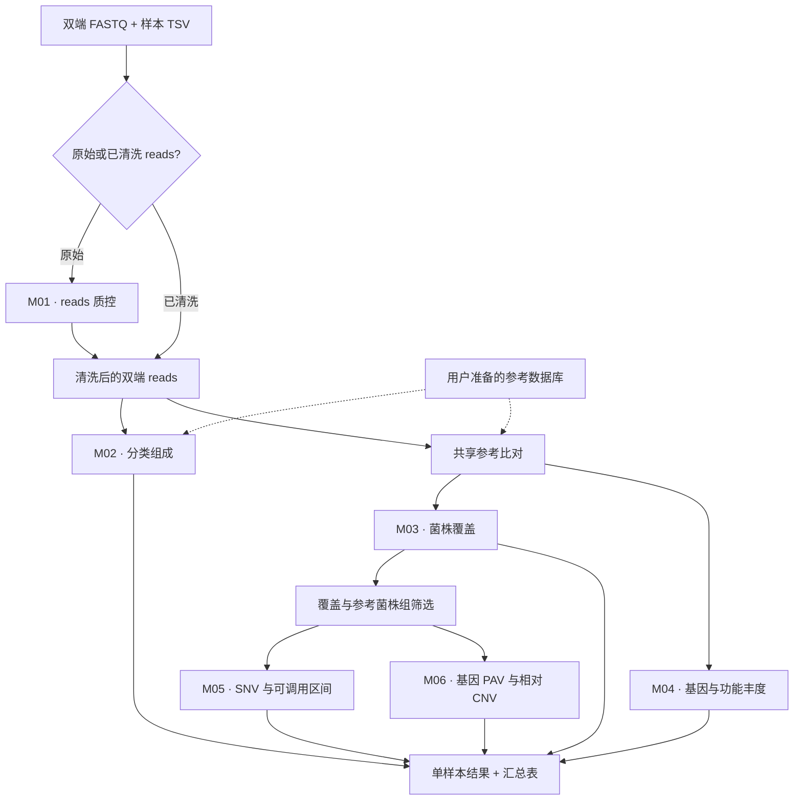

# SynCom-MetaFlow

**面向双端合成微生物群落宏基因组数据的模块化参考分析流程。**

[English](README.md) · **简体中文**

从双端 reads 出发，完成分类组成、参考菌株覆盖、基因与功能丰度、单核苷酸变异，以及基因存在/缺失和相对拷贝数分析。按需选择模块，检查生成的 Bash 任务，在指定的分析目录中运行或续跑。

> **使用前须知：** 本仓库提供核心代码和配置示例，不包含参考数据库、测序数据、分析结果或开发测试文件。请自行准备兼容数据库，并安装所选模块需要的软件。

[工作流程](#工作流程) · [模块总览](#模块总览) · [快速上手](#快速上手) · [输入要求](#输入要求) · [输出结果](#输出结果) · [结果解释与默认阈值](#结果解释与默认阈值)

## 工作流程



Python 主控校验输入、补充模块依赖并生成 Bash 执行计划。`plan` 仅导出计划；`run` 导出后立即执行。当前按样本串行运行，各分析工具内部使用线程。M03 和 M04 共用排序后的参考比对 BAM。比对时 BWA 与排序同时执行，各至少占用一个核；即使设置 `--threads 1`，也应分配至少两个核。

## 模块总览

| 模块 | 分析内容 | 主要软件 | 主要汇总输出 |
|---|---|---|---|
| **M01** | 双端 reads 质控 | fastp | `qc.tsv` |
| **M02** | 分类组成与相对丰度 | mOTUs、BWA | `taxonomy.tsv`、`taxonomy_matrix.tsv` |
| **M03** | 参考菌株及近乎相同参考组的覆盖 | BWA、samtools | `strains.tsv`、`strains_matrix.tsv`、`strain_groups_matrix.tsv` |
| **M04** | 基因及已有注释功能的丰度 | BWA、samtools、featureCounts | `genes.tsv`、`functions.tsv`、基因/功能 FPKM 矩阵 |
| **M05** | 群体 SNV 与可调用区间 | M03 依赖软件、bcftools | `snv.tsv`、`snv_eligibility.tsv` |
| **M06** | 基因存在/缺失及相对拷贝数 | M03 依赖软件 | `pav_cnv.tsv`、基因 PAV/CNV 矩阵、`pav_cnv_eligibility.tsv` |

**依赖规则：** 原始 reads 输入自动加入 M01。选择 M05 或 M06 自动加入 M03。已经清洗、且每样本恰好只有一对 FASTQ 时，可用 `--clean-reads` 跳过质控；该参数不能与 M01 同时使用。

## 快速上手

### 1. 获取代码并配置软件

使用 Linux、Python 3.10+（开发环境使用 Python 3.12）、Bash、GNU 命令行工具和 `flock`。Python 主控仅使用标准库。

```bash
git clone https://github.com/Astudentx/SynComMeta.git
cd SynComMeta

# 修改右列，填写 PATH 中的命令名或可执行文件路径。
cp config/tools.example.tsv config/tools.local.tsv
./syncom-metaflow doctor --tools config/tools.local.tsv
./syncom-metaflow modules
```

`doctor` 检查全部六个模块的软件能否被定位，不校验数据库，也不执行完整分析。`plan` 和 `run` 只检查所选模块及其依赖需要的软件。如果仅运行部分模块，请参见[软件配置](#软件配置)。

### 2. 准备输入

准备制表符分隔的样本表，以及含有 `manifest.tsv` 的兼容数据库目录。将下文的 `/path/to/samples.tsv` 和 `/path/to/SynComDB` 替换为实际路径。具体格式见[输入要求](#输入要求)。

### 3. 运行全部模块

```bash
./syncom-metaflow run \
  --samples /path/to/samples.tsv \
  --db /path/to/SynComDB \
  --tools config/tools.local.tsv \
  --modules M01,M02,M03,M04,M05,M06 \
  --threads 4 \
  --outdir results/batch01
```

先查看 `results/batch01/summary/` 中的汇总表，并通过 `results/batch01/provenance/status.tsv` 确认运行是否完成。

### 4. 或先导出任务，再执行

```bash
./syncom-metaflow plan \
  --samples /path/to/samples.tsv \
  --db /path/to/SynComDB \
  --tools config/tools.local.tsv \
  --modules M01,M02,M03,M04,M05,M06 \
  --threads 4 \
  --outdir results/batch01

nohup bash results/batch01/shell/run_all.sh \
  > results/batch01/run.log 2>&1 &
```

使用绝对路径时，可从任意工作目录调用生成的 `shell/run_all.sh`。也可在 HPC 批处理作业中调用该入口，调度器提交需自行安排。计划保留 reads、数据库和软件路径，执行时这些资源必须仍可访问。

## 输入要求

### 样本表

使用**带表头的 TSV 文件**，格式参见 [examples/samples.tsv](examples/samples.tsv)：

```tsv
sample_id	r1	r2	lane_id
sample01	reads/sample01_L001_R1.fastq.gz	reads/sample01_L001_R2.fastq.gz	L001
sample01	reads/sample01_L002_R1.fastq.gz	reads/sample01_L002_R2.fastq.gz	L002
sample02	reads/sample02_L001_R1.fastq.gz	reads/sample02_L001_R2.fastq.gz	L001
```

| 字段 | 是否必需 | 含义 |
|---|---|---|
| `sample_id` | 是 | 样本 ID，以字母或数字开头，仅含字母、数字、`_`、`.` 或 `-` |
| `r1`、`r2` | 是 | 两端 FASTQ 路径；相对路径以样本表所在目录为基准 |
| `lane_id` | 多 lane 时必需 | 同一样本内唯一；按表中行序合并后质控 |
| 其他列 | 否 | 分组、对照或接种组合等信息，保留在输入快照中 |

单 lane 样本可省略 `lane_id`。使用 `--clean-reads` 时，每样本只能提供一对 FASTQ。示例表仅用于展示格式，仓库不附带对应 reads。

### 参考数据库

`--db` 指向含有**两列、无表头** `manifest.tsv` 的目录。清单中的相对路径以该目录为基准，也支持绝对路径。

```tsv
db_version	my_syncom_v1
reference	reference.fa
contig_map	contig_map.tsv
motus_db	motus_db
genes_saf	gene_assets/genes.saf
genes_bed	gene_assets/genes.bed
annotations	gene_assets/annotations.tsv
strains	strains.tsv
```

这是结构示例，不是可直接下载的数据库。按所选模块准备相应条目：

| 条目 | 使用模块 | 要求 |
|---|---|---|
| `db_version` | 所有运行 | 非空版本标识，仅含字母、数字、`_`、`.` 或 `-` |
| `reference` | M03–M06 | 联合 FASTA，附带 BWA 索引（`.amb`、`.ann`、`.bwt`、`.pac`、`.sa`）和 samtools `.fai` |
| `contig_map` | M03–M06 | 含 `contig_id`、`genome_id`、`original_contig_id`、`length_bp` 的 TSV；contig 名称与长度须匹配 FASTA 索引 |
| `motus_db` | M02 | 兼容的 mOTUs 数据库目录，包含 `db_mOTU_versions` |
| `genes_saf` | M04 | 与联合参考匹配的 SAF 基因坐标 |
| `annotations` | M04 | 含 `gene_id`、`source`、`function_id` 的 TSV |
| `genes_bed` | M06 | 无表头 BED：contig、起点、终点、基因 ID、基因组 ID；采用 0 基半开区间 |
| `strains` | 可选 | 含 `ID` 和非空 `strain_id` 的 TSV；ID 必须匹配参考基因组。`ANI >= 99.99 Group` 列用于近乎相同参考的分组 |

M05/M06 通过 M03 继承参考输入要求。各文件的参考名称、基因 ID、坐标和注释 ID 必须一致。

`scripts/build_gene_assets.py` 从脚本所要求的源目录结构中导入 CDS 坐标和已有注释，对照联合参考验证 CDS 序列，生成基因资产及导入报告。该脚本并非通用数据库下载器或注释流程：

```bash
python3 scripts/build_gene_assets.py --help
```

### 软件配置

公开版 [config/tools.tsv](config/tools.tsv) 和 [config/tools.example.tsv](config/tools.example.tsv) 使用 `PATH` 中的通用命令名。自定义配置同样采用**两列、无表头 TSV**：

```tsv
fastp	fastp
bwa	bwa
samtools	samtools
motus	motus
featureCounts	featureCounts
bcftools	bcftools
```

右列也可填写可执行文件路径。相对软件路径以配置文件所在目录为基准。用 `--tools` 指定配置；未指定时使用 `config/tools.tsv`。

原开发环境使用 fastp 0.23.1、BWA 0.7.17、samtools 1.20、featureCounts 1.6.3、bcftools 1.19，以及报告版本为 `3.0.1_NEWDB` 的定制 mOTUs 环境。这是已测试环境的记录，不代表所有版本和数据库均已验证兼容。每次运行会记录实际软件版本。

## 常用命令

| 任务 | `run` 或 `plan` 使用的参数 |
|---|---|
| 仅质控 | `--modules M01` |
| 原始 reads 的菌株覆盖分析 | `--modules M03`（自动加入 M01） |
| 已清洗 reads 的分类与菌株覆盖 | `--clean-reads --modules M02,M03` |
| 基因与功能丰度 | `--modules M04`（自动加入 M01） |
| SNV 与基因 PAV/CNV | `--modules M05,M06`（自动加入 M01、M03） |

每条命令仍需指定 `--samples`、`--db`、`--outdir` 并使用适当的软件配置。调整 M05/M06 的基因组筛选阈值时，可添加 `--min-genome-depth 5 --min-genome-breadth 0.5`，将数值替换为需要的设置。

### 续跑

```bash
bash results/batch01/shell/run_all.sh
```

重新使用原来的 `run` 命令也支持续跑。流程核对记录的输入标识、数据库信息、参数、软件与预期产物，复用有效任务并重跑受影响任务。每项任务有独立日志。`shell/` 指向当前计划快照，`scripts/` 是兼容入口。

### 合并已完成批次

```bash
./syncom-metaflow merge \
  --outdir results/combined \
  results/batch01 results/batch02
```

批次必须已完成，且数据库标识、软件版本、模块和参数兼容。样本 ID 须跨批次唯一，合并输出目录须为新目录。合并从长表重新生成汇总矩阵并记录样本来源；单样本 BAM、日志和可调用区间保留在原批次中。

## 输出结果

```text
results/batch01/
├── shell/                 # 当前执行计划：run_all.sh、任务、配置和输入快照
├── summary/               # 汇总长表与“实体 × 样本”矩阵
├── qc/                    # M01：clean reads、fastp JSON 和 HTML
├── taxonomy/              # M02：mOTUs 原始输出与标准表
├── strains/               # M03：contig、基因组与参考组覆盖
├── functions/             # M04：featureCounts 输出与丰度表
├── snv/                   # M05：SNV、可调用 BED 与筛选状态
├── pav_cnv/               # M06：基因覆盖、PAV/CNV 与筛选状态
├── work/                  # 共享比对与中间文件
├── logs/                  # 各任务执行日志
└── provenance/            # 完成状态、软件版本和汇总目录清单
```

实际目录与表格取决于所选模块。矩阵以实体为行、样本为列。`summary/` 中的主要文件如下：

| 想了解的问题 | 查看文件 |
|---|---|
| 多少 read pairs 通过质控？ | `qc.tsv` |
| 检测到哪些分类单元？ | `taxonomy.tsv`、`taxonomy_matrix.tsv` |
| 参考菌株的覆盖情况如何？ | `strains.tsv`、`strains_matrix.tsv`、`strain_groups.tsv`、`strain_groups_matrix.tsv` |
| 哪些基因和功能丰度较高？ | `genes.tsv`、`functions.tsv`、`gene_fpkm_matrix.tsv`、`function_fpkm_matrix.tsv` |
| 哪些 SNV 通过筛选？ | `snv.tsv`、`snv_eligibility.tsv`；同时查看单样本 `callable.bed` |
| 哪些基因存在、缺失或不确定？ | `pav_cnv.tsv`、`gene_pav_matrix.tsv`、`gene_cnv_matrix.tsv`、`pav_cnv_eligibility.tsv` |

以 `provenance/status.tsv` 确认完成状态，通过 `provenance/versions.tsv` 查看软件版本，通过 `provenance/summary_catalog.tsv` 查看本次运行发布的汇总结果。

## 结果解释与默认阈值

| 分析 | 定义与解释 |
|---|---|
| **M02 分类组成** | 使用 mOTUs 相对丰度。定制数据库中相同的重复 `unassigned` 条目在标准输出中仅保留一次。无标记信号时可能输出全零谱。 |
| **M03 菌株覆盖** | `reads_mapq20` 为 MAPQ ≥20 的 reads 数。平均深度按 contig 长度加权。`target_depth_fraction` 为单个参考的平均深度占所有目标参考平均深度之和的比例；所有目标均无覆盖时为 `NA`，不能直接解释为细胞数量比例。 |
| **M03 菌株组** | 根据提供的 ANI ≥99.99% 分组元数据汇总高 MAPQ 证据。多重比对 reads 不重新分配，组级结果反映可用的高置信证据。 |
| **M04 丰度** | 在联合参考上统计符合条件的双端片段。FPKM 分母为全部 clean read pairs，长度为参考 CDS 长度。功能丰度按注释源及条目汇总基因 FPKM；由于注释可能重叠，功能条目之和不一定等于基因总丰度。 |
| **M05/M06 参考筛选** | 默认要求基因组覆盖广度 ≥0.5、平均深度 ≥5；提供分组元数据时，排除多成员 ANI ≥99.99% 组中的参考。无该分组列时仅按覆盖筛选。 |
| **M05 SNV** | 基于 bcftools pileup 证据，不进行二倍体基因型推断。要求位点深度 ≥5、ALT 碱基数 ≥3、正反链各 ≥1 个 ALT 碱基、ALT 频率 ≥5%。`snv.tsv` 为 1 基坐标，`callable.bed` 为 0 基半开区间。空 SNV 表须结合可调用区间和参考筛选状态解释。 |
| **M06 PAV/CNV** | `present`：基因广度 ≥80% 且深度 ≥1。`absent`：基因组平均深度 ≥10 且基因完全无覆盖。其他为 `uncertain`，拷贝数为 `NA`。相对拷贝数为基因平均深度与参考基因组平均深度之比。 |

开发检查覆盖多 lane 输入、带空格路径、导出与直接执行的一致性、BAM 索引缺失后的续跑、已知模拟 SNV、基因/功能计数、PAV/CNV、低覆盖筛选及跨批合并。也使用模拟 reads 对本地 122 株参考 SynCom 数据库和定制 mOTUs 数据库进行了联测。这些开发数据与测试文件不随仓库发布。真实实验样本需要适当对照来评估污染、参考可区分性及检测限；覆盖不均和近缘背景菌会影响基因层面的估计。

## 仓库结构

```text
SynComMeta/
├── syncom-metaflow          # 命令行入口
├── syncom/
│   ├── cli.py              # 输入校验、依赖与执行计划生成
│   ├── modules/            # M01–M06 及共享比对/覆盖命令
│   └── *.bash              # 运行时、汇总表与跨批合并
├── scripts/
│   └── build_gene_assets.py
├── config/                 # 通用软件配置与示例
├── examples/               # 样本表格式
├── README.md               # 英文主文档
└── README.zh-CN.md          # 对应中文文档
```

数据库、原始 reads、分析结果、缓存、本机配置覆盖文件、开发提示词和测试文件均不随代码发布。
